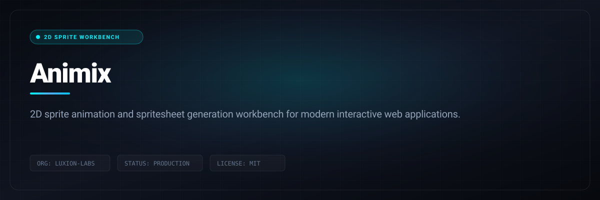

# Animix

> 2D sprite animation and spritesheet generation workbench for modern interactive web applications.



<p align="center">
  
  &nbsp;
  
  &nbsp;
  
  &nbsp;
  
  &nbsp;
  
  &nbsp;
  
</p>

<p align="center">
  <a href="LICENSE"></a>
  &nbsp;
  <a href="CONTRIBUTING.md"></a>
</p>

---

## Quick Start & Getting Started

Getting Animix running locally takes only two steps:

```bash
git clone https://github.com/Luxion-Labs/animix.git
cd animix
npm install && npm run dev
```

Open [http://localhost:5173](http://localhost:5173) in your browser.

---

## Features

- **AI-Assisted Asset Generation**  -  Generate animation spritesheets from text prompts or reference images using Google Gemini, with automatic procedural fallbacks.
- **Spritesheet Pipeline**  -  Import custom spritesheets, auto-normalize frame grids, and preview frames before saving to the asset library.
- **Scene Builder**  -  Drag-and-drop multi-layer scene editor with player layers, backgrounds, grounds, and interaction zones.
- **Live Animation Playback**  -  Play, pause, and inspect frame-by-frame animations directly in the browser with configurable FPS.
- **Interaction System**  -  Design inspectable items, dialogue triggers, light zones, camera zones, audio zones, vehicle pickups, and nearby-proximity prompts.
- **Scene Flow Graph**  -  Visually wire multiple scenes, animation scenes, and start UIs together with transitions (cut, dissolve, etc.).
- **Start UI Designer**  -  Build custom title screens with configurable primary/secondary actions, options, and scene flow connections.
- **Animation Scene Editor**  -  Sequence multiple layers across timed tracks with playback and scene-transition outputs.
- **Global Lighting & Shadows**  -  Apply neon, dim, spotlight, or custom lighting presets to individual layers and the entire scene.
- **Asset Provenance**  -  SHA-256 and MD5 checksums for every generated or processed asset, with full metadata manifests.
- **Export Media**  -  Export spritesheets to GIF or WebM video with custom frame rate and resolution settings.
- **Neon Lighting Engine**  -  Built-in neon contact-shadow presets and per-layer global lighting controls.

---

## Tech Stack

| Area | Tooling |
|------|---------|
| **Frontend** | React 19, TypeScript 5.8, Tailwind CSS 4, Vite 8, Motion |
| **Backend** | Node.js, Express 4 |
| **AI** | Google Gemini API (`@google/genai`) |
| **Server Runtime** | `tsx` (dev), `esbuild` (production build) |
| **Icons & UI** | Lucide React |

---

## Getting Started

### Prerequisites

- **Node.js** 18+ and npm
- **Git**
- **ffmpeg** (optional, required for GIF and WebM export)
- **Gemini API Key** (optional, enables cloud AI generation)

### Install

```bash
npm install
```

### Environment

Copy `.env.example` to `.env.local` and configure as needed:

```bash
cp .env.example .env.local
```

```env
# .env.local
GEMINI_API_KEY="your-gemini-api-key"
PORT=3000
PORT_SCAN_LIMIT=30
```

> The local spritesheet and scene editing workflow runs fully offline without an API key. Set `GEMINI_API_KEY` only if you want AI-powered generation.

### Development

```bash
npm run dev
```

Starts the Express server with Vite middleware and opens the app at `http://localhost:3000` (or the next available port).

### Production Build

```bash
npm run build
npm start
```

- `build` compiles the Vite frontend and bundles `server.ts` with `esbuild` into `dist/server.cjs`.
- `start` runs the production server from the bundled output.

### Clean Build Artifacts

```bash
npm run clean
```

### Lint / Typecheck

```bash
npm run lint
```

---

## How It Works

1. **Generate or Import Assets**
   - Prompt AI to generate a spritesheet (`Gemini`).
   - Upload a custom PNG spritesheet and normalize frame grids.
   - Use built-in procedural fallback animations when the cloud is busy.

2. **Edit & Inspect**
   - View individual frames, adjust FPS, and compile sheets to PNG.
   - Inspect lighting, shadows, and layer transforms.
   - Tag assets with roles (`player`, `npc`, `effect`, etc.) and custom tags.

3. **Build Scenes**
   - Add layers: backgrounds, grounds, avatars, effects, interaction zones.
   - Configure interaction presets (`inspect`, `dialogue`, `vehicle`, `light-zone`, etc.).
   - Fine-tune global neon lighting and per-layer shadow presets.

4. **Connect Flow**
   - Switch to **Scene Flow** view to wire scenes and animation scenes into a playable graph.
   - Design Start UI screens with actions that navigate between nodes.
   - Define transition types, durations, and automatic or manual triggers.

5. **Export**
   - Download individual spritesheet frames or the full compiled PNG.
   - Export animations as GIF or WebM at custom frame rates and resolutions.

---

---

## Maintainer Response SLA
Luxion Labs enforces a strict 24-hour response SLA on all community issues, feature proposals, and pull requests. See [CONTRIBUTING.md](CONTRIBUTING.md) for full development guidelines.

## License
Distributed under the MIT License. See [LICENSE](LICENSE) for details.
